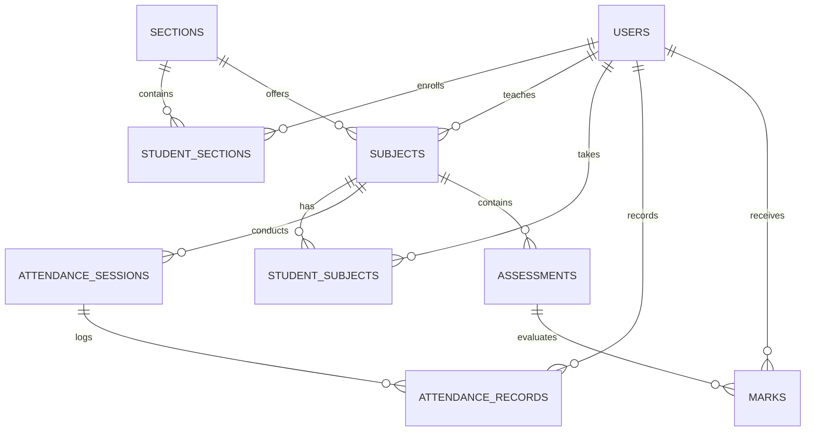

# EduTrack — Student Attendance and Academic Performance Tracker

> **Problem Statement #4: Student Attendance and Academic Performance Tracker**  
> An enterprise-grade, user-friendly Student Information System (SIS) and Learning Management System (LMS) module enabling faculty to record attendance, manage internal assessment marks, and empower students to monitor their academic progress with interactive charts and alerts.

---

## 🌟 Key Highlights & Features

- 🔐 **Dual Role-Based Authentication (Faculty & Student)**
  - JWT token authentication with role-based route security.
  - Interactive **1-Click Demo Login Switcher** for rapid evaluation of faculty workflows and varying student performance scenarios.
- 📚 **Subject & Class Section Management**
  - Create and configure course subjects with course code, credit hours, planned lectures, and mandatory attendance thresholds (e.g., 75%).
  - Manage class sections and cohorts (semester, academic year, department).
- 📅 **Interactive Attendance Recording & Tracking**
  - Date-wise lecture roster with topic coverage recording.
  - 4-state student attendance markers: `Present` (Green), `Late` (Amber), `Absent` (Rose), `Excused` (Slate).
  - 1-Click batch actions: `Mark All Present` and `Mark All Absent`.
  - Real-time counter of session attendance percentage.
  - History log of all past sessions with **one-click CSV export**.
- 📝 **Internal Assessment Marks Entry**
  - Create custom assessment components (Quiz, Internal Test, Assignment, Lab Practical, Project).
  - Batch spreadsheet mark entry sheet with validation against max marks.
  - Instant live calculations: **Class Average, Highest Score, Lowest Score, Pass Count, and Pass Percentage**.
- 🧮 **Academic Statistics & Grade Computations**
  - Overall & subject-wise attendance percentage: `(Attended / Total Sessions) * 100`.
  - Weighted internal assessment percentage calculation.
  - Letter grade mapping (`A+`, `A`, `B+`, `B`, `C`, `P`, `F`) and Grade Points (10-point scale).
  - Cumulative Grade Point Average (CGPA) aggregation.
- 🚨 **Intelligent Alerts & Remedial Interventions**
  - ⚠️ **Critical Low Attendance Alert (< 75%)**: Dynamic recovery formula calculating the **exact number of consecutive upcoming classes** a student must attend to cross the 75% threshold!
  - 💡 **Academic Risk Warning (< 50% score)**: Highlights specific tests needing improvement.
  - 🏆 **Dean's Honor Roll Recognition**: Automatically badges top performers (>85% attendance, >8.5 CGPA).
- 📊 **Visual Analytics (Chart.js)**
  - Subject-wise attendance bar chart with 75% threshold baseline indicator.
  - Attendance status breakdown doughnut chart (Present vs Late vs Absent vs Excused).
  - Subject internal score vs Class average comparison bar chart.

---

## 🛠️ Technology Stack

| Layer | Technology | Details |
|---|---|---|
| **Frontend UI/UX** | **React 18 + Vite + Tailwind CSS** | Clean modern aesthetic, responsive tables, modal dialogs, status badges |
| **Data Visualizations** | **Chart.js + react-chartjs-2** | Bar charts, Doughnut charts, responsive canvas rendering |
| **Icons & Design** | **Lucide React** | Modern minimalist icon set |
| **Backend API** | **Node.js + Express.js** | Modular RESTful architecture, JWT authentication, CORS enabled |
| **Database** | **SQLite3 (sql.js engine)** | Zero-config persistent database (`database.sqlite`), relational schema, automated sample data seeding |
| **Evaluation Tools** | **Postman / REST Client** | Standard JSON responses, Postman-ready REST API |

---

## 🚀 Prototype Workflow (Expected Flow)

```
Login ➔ Select Subject ➔ Record Attendance / Marks ➔ Calculate Statistics ➔ View Student Dashboard
```

1. **Login**: Access either the **Faculty Portal** or **Student Portal** (or click any 1-Click demo scenario).
2. **Select Subject**: Choose from assigned subjects (e.g., `CS501 - Database Management Systems`).
3. **Record Attendance / Marks**:
   - For Attendance: Pick date, enter lecture topic, toggle student statuses, click **"Save & Submit Attendance"**.
   - For Marks: Pick assessment (e.g. *Midterm Internal Exam*), enter marks in the roster sheet, click **"Save & Publish Marks"**.
4. **Calculate Statistics**: The system aggregates overall attendance, weighted internals, class averages, and CGPA in real-time.
5. **View Student Dashboard**: Switch to student view (e.g., *Rahul Verma* or *Aarav Patel*) to see live recovery alerts, status charts, and subject scorecards.

---

## 🔑 Demo Accounts (Pre-Seeded)

All demo accounts have password: `password123`

| Name | Role | Email | Scenario / Highlights |
|---|---|---|---|
| **Prof. Rajesh Sharma** | Faculty | `prof.sharma@college.edu` | Teaches DBMS & Operating Systems. Full grading & attendance controls. |
| **Dr. Anita Desai** | Faculty | `dr.anita@college.edu` | Teaches Computer Networks. |
| **Aarav Patel** | Student | `aarav.patel@student.edu` | **94% Attendance • Top Achiever • A+ Grade** |
| **Rahul Verma** | Student | `rahul.verma@student.edu` | ⚠️ **58% Attendance • Active Critical Alert (<75%) • Academic Support Alert** |
| **Vikram Mehta** | Student | `vikram.mehta@student.edu` | ⚠️ **75% Attendance • Borderline Attendance Warning** |
| **Priya Singh** | Student | `priya.singh@student.edu` | **88% Attendance • Consistent Performer** |

---

## 💻 How to Run the Application

### Option 1: Run Both with Single Root Command (Recommended)

From the project root directory (`student-tracker`):

```bash
# 1. Install root dependencies (concurrently)
npm install

# 2. Launch both Backend (port 5000) and Frontend (port 3000) together
npm run dev
```

Open your browser to: **`http://localhost:3000`**

### Option 2: Run Backend and Frontend Separately

**Terminal 1 — Backend API:**
```bash
cd backend
npm install
npm start
# Server starts on http://localhost:5000
```

**Terminal 2 — Frontend UI:**
```bash
cd frontend
npm install
npm run dev
# Vite starts on http://localhost:3000
```

---

## 📡 REST API Reference (Postman Guide)

Base URL: `http://localhost:5000/api`

### 1. Authentication
- `POST /api/auth/login` — Login with `{ email, password, role }`
- `GET /api/auth/me` — Get current logged-in user profile (Bearer Token required)
- `GET /api/auth/demo-users` — Fetch demo accounts list
- `POST /api/auth/register` — Register new student or faculty

### 2. Subjects
- `GET /api/subjects` — Get subjects list
- `GET /api/subjects/:id` — Get subject details
- `GET /api/subjects/:id/students` — Get enrolled students with attendance & score stats
- `POST /api/subjects` — Create new subject `{ code, name, credits, section_id, total_classes_planned, attendance_threshold }`
- `PUT /api/subjects/:id` — Update subject
- `DELETE /api/subjects/:id` — Delete subject

### 3. Class Sections
- `GET /api/sections` — List class sections
- `POST /api/sections` — Create section `{ name, semester, academic_year, department }`
- `GET /api/sections/:id` — Get section details & enrolled students
- `POST /api/sections/:id/enroll` — Enroll student into section

### 4. Attendance
- `GET /api/attendance/sessions?subjectId=:id` — List all attendance sessions
- `GET /api/attendance/sessions/:id` — Get session roster
- `POST /api/attendance/sessions` — Record new attendance session `{ subject_id, date, topic, records: [{ student_id, status, remarks }] }`
- `PUT /api/attendance/sessions/:id` — Update session attendance
- `DELETE /api/attendance/sessions/:id` — Delete attendance session
- `GET /api/attendance/student/:studentId` — Get full attendance calendar for a student

### 5. Internal Assessments & Marks
- `GET /api/assessments?subjectId=:id` — List assessments for subject
- `POST /api/assessments` — Create assessment `{ subject_id, title, type, max_marks, weightage, date }`
- `GET /api/assessments/:id/marks` — Get marks sheet for assessment with class averages
- `POST /api/assessments/:id/marks` — Batch save marks `{ marks: [{ student_id, marks_obtained, remarks }] }`
- `PUT /api/assessments/:id` — Update assessment details
- `DELETE /api/assessments/:id` — Delete assessment

### 6. Statistics & Dashboards
- `GET /api/stats/student-dashboard` — Calculate complete student scorecard, attendance percentages, CGPA, and alerts
- `GET /api/stats/faculty-dashboard` — Get faculty summary, at-risk watchlist, recent sessions, and class averages

---

## 🗄️ Relational Database Schema



---

## 💡 Mathematical Formulas Implemented

1. **Attendance Percentage**:
   $$\text{Attendance \%} = \frac{\text{Present} + 0.5 \times \text{Late}}{\text{Total Sessions Conducted}} \times 100$$

2. **Consecutive Classes Required to Recover Attendance Threshold ($T = 75\%$)**:
   $$\text{Classes to Attend} = \left\lceil \frac{T \times \text{Total Sessions} - \text{Attended}}{1 - T} \right\rceil$$

3. **Cumulative Grade Point Average (CGPA)**:
   $$\text{CGPA} = \frac{\sum (\text{Grade Points}_i \times \text{Credits}_i)}{\sum \text{Credits}_i}$$

---

Developed as a modern, accessible, and user-friendly solution for institutional academic monitoring.
